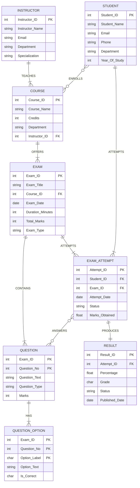

# ONLINE EXAMINATION SYSTEM
## PROJECT REPORT — DATABASE MANAGEMENT SYSTEM

**Class:** II-II CSE-A  
**Subject:** Database Management Systems  
**RDBMS Used:** MySQL 8.0 (works on MySQL Workbench / phpMyAdmin / MariaDB)  
**Project files:** `01_schema.sql`, `02_data.sql`, `03_queries.sql`, `04_views.sql`, `05_triggers.sql`

---

# 1. PROBLEM STATEMENT

## 1.1 Background

Examinations in most colleges are still conducted on paper: the question paper is
typed in Word, printed, collected, evaluated by hand and the marks are entered in
an Excel sheet. This process is slow, error-prone, and the results are not available
to the student quickly. As the number of courses, questions and students grows, it
becomes impossible to keep the data consistent, secure and easy to query
("How many students failed in Operating Systems?", "Which is the easiest exam?",
"Show me the mark sheet of roll number 1005" — none of these can be answered
instantly from paper records).

## 1.2 Proposed System

The **Online Examination System** is a database-driven application that manages the
complete life cycle of an online examination:

> **Registration & enrolment → question-paper creation → exam scheduling →
> student attempt → automatic evaluation → result publication → reports.**

All data is stored in a relational database, so redundancy is controlled, integrity
is enforced by the DBMS itself (keys, constraints, triggers), and any report can be
produced instantly with an SQL query.

## 1.3 Users of the System

| User | What he/she does in the system |
|---|---|
| **Student** | Registers, enrols in courses, views the exam schedule, attempts a published exam, views the graded result / mark sheet |
| **Instructor (Faculty)** | Creates and updates courses, uploads the question paper with options and answer key, schedules exams, views course-wise performance analytics |
| **Administrator** | Maintains the master data (students, instructors, courses), monitors exams, publishes results, generates reports |

## 1.4 Functional Requirements

1. Store student, instructor and course information (with unique e-mail / phone).
2. A student may enrol in **many** courses and a course may have **many** students.
3. An instructor teaches one or more courses; each course is offered in the system.
4. An instructor creates an exam for a course and uploads MCQ questions, each with
   four options and exactly one correct option.
5. A student attempts a scheduled exam; **only one attempt per student per exam**
   is allowed (enforced by a UNIQUE constraint).
6. Every selected option is stored; the marks of each answer are added up
   automatically (trigger) to produce the total marks of the attempt.
7. Percentage, grade (A/B/C/D/F) and PASS/FAIL status are computed and published
   (auto-computed by a trigger).
8. Reports: mark sheet, course-wise average, pass/fail counts, topper of an exam,
   upcoming exam schedule, students who never attempted an exam, etc.

## 1.5 Scope / Feasibility

* Handles 20+ exams, question papers, answer keys, attempts and results in the
  sample data — scales to thousands of rows without any change in design.
* All queries run on standard SQL, so the design can be ported to Oracle/PostgreSQL
  with minor syntax changes.
* Security (login), web front-end and auto-proctoring are **outside the scope** of
  this DBMS project — only the database design, constraints, queries, views and
  triggers are implemented.

---

# 2. ER DIAGRAM

## 2.1 Notation Used (as required)

| Symbol | Meaning | Used for |
|---|---|---|
| **Rectangle** | Entity | STUDENT, INSTRUCTOR, COURSE, EXAM, RESULT, EXAM_ATTEMPT |
| **Double rectangle** | **Weak entity** | QUESTION (exists only inside an EXAM), QUESTION_OPTION (exists only inside a QUESTION) |
| **Oval** | Attribute | STUDENT_NAME, EXAM_DATE, PERCENTAGE … |
| **Dashed oval** | Partial key of a weak entity | QUESTION_NO, OPTION_LABEL |
| **Diamond** | Relationship | ENROLLS, TEACHES, OFFERS, CONTAINS, HAS, ATTEMPTS, ANSWERS, PRODUCES |
| **Double diamond** | Identifying relationship of a weak entity | CONTAINS, HAS |
| **Underline** | Primary key | STUDENT_ID, (EXAM_ID + QUESTION_NO) … |
| **Solid line** | Total participation (compulsory) | every EXAM must belong to a COURSE |
| **Dashed line** | Partial participation (optional) | a student need not have attempted an exam yet |

## 2.2 Entities and Attributes (8 entities + 2 relationship tables)

| Entity | Type | Attributes (PK underlined, FK marked) | Max attrs |
|---|---|---|---|
| **STUDENT** | Strong | <u>STUDENT_ID</u>, STUDENT_NAME, EMAIL (U), PHONE (U), DEPARTMENT, YEAR_OF_STUDY | 6 |
| **INSTRUCTOR** | Strong | <u>INSTRUCTOR_ID</u>, INSTRUCTOR_NAME, EMAIL (U), DEPARTMENT, SPECIALIZATION | 5 |
| **COURSE** | Strong | <u>COURSE_ID</u>, COURSE_NAME (U), CREDITS, DEPARTMENT, *INSTRUCTOR_ID* (FK) | 5 |
| **EXAM** | Strong | <u>EXAM_ID</u>, EXAM_TITLE, *COURSE_ID* (FK), EXAM_DATE, DURATION_MINUTES, TOTAL_MARKS, EXAM_TYPE | 7 |
| **QUESTION** | **Weak** (double rectangle) | (<u>EXAM_ID</u> + <u>QUESTION_NO</u> dashed), QUESTION_TEXT, QUESTION_TYPE, MARKS | 5 |
| **QUESTION_OPTION** | **Weak** | (<u>EXAM_ID</u> + <u>QUESTION_NO</u> + <u>OPTION_LABEL</u>), OPTION_TEXT, IS_CORRECT | 5 |
| **EXAM_ATTEMPT** | Associative entity | <u>ATTEMPT_ID</u>, *STUDENT_ID* (FK), *EXAM_ID* (FK), ATTEMPT_DATE, STATUS, MARKS_OBTAINED | 6 |
| **RESULT** | Strong | <u>RESULT_ID</u>, *ATTEMPT_ID* (FK, U), PERCENTAGE, GRADE, STATUS, PUBLISHED_DATE | 6 |
| **ENROLLMENT** | Table of M:N relation ENROLLS | <u>STUDENT_ID</u> + <u>COURSE_ID</u> (both FK), ENROLL_DATE, STATUS | 4 |
| **ANSWER** | Table of M:N relation ANSWERS | <u>ATTEMPT_ID</u> + <u>EXAM_ID</u> + <u>QUESTION_NO</u>, SELECTED_LABEL, IS_CORRECT, MARKS_SCORED | 6 |

(U) = UNIQUE, FK = Foreign key, underlined = Primary key.  
Every entity has 4–7 attributes (maximum allowed is 7–8) and **every entity has a
primary key**.

## 2.3 Relationships, Cardinality and Participation (8 relationships)

| # | Relationship (verb) | Between | Cardinality | Participation | Realised as table |
|---|---|---|---|---|---|
| 1 | **ENROLLS** | STUDENT – COURSE | **M : N** (one student → many courses; one course → many students) | STUDENT **partial** (student 1023 has not enrolled yet), COURSE **partial** (a new course may have no student) | `ENROLLMENT` |
| 2 | **TEACHES** | INSTRUCTOR – COURSE | **1 : M** | COURSE **total** (every course must have one instructor), INSTRUCTOR **partial** (may teach 0 courses) | `COURSE.Instructor_ID` |
| 3 | **OFFERS** | COURSE – EXAM | **1 : M** | EXAM **total** (every exam belongs to a course), COURSE **partial** (course with no exam yet) | `EXAM.Course_ID` |
| 4 | **CONTAINS** (identifying, double diamond) | EXAM – QUESTION | **1 : M** | QUESTION **total** (weak entity ⇒ compulsory), EXAM **partial** (upcoming exams have no paper yet) | `QUESTION` (composite PK) |
| 5 | **HAS** (identifying, double diamond) | QUESTION – QUESTION_OPTION | **1 : M** | both **total** (an option needs a question; an MCQ needs options) | `QUESTION_OPTION` |
| 6 | **ATTEMPTS** | STUDENT – EXAM | **M : N** (realised by associative entity EXAM_ATTEMPT) | STUDENT **partial** (1023 never attempted), EXAM **partial** (upcoming exams not attempted) | `EXAM_ATTEMPT` |
| 7 | **ANSWERS** | EXAM_ATTEMPT – QUESTION | **M : N** | both **total** (an answer needs an attempt and a question) | `ANSWER` |
| 8 | **PRODUCES** | EXAM_ATTEMPT – RESULT | **1 : 1** | RESULT **total** (a result must belong to one attempt), EXAM_ATTEMPT **partial** (result published 3 days later) | `RESULT.Attempt_ID` (UNIQUE) |

### Cardinality coverage (required by rules)
* **1 : 1** → PRODUCES (one attempt produces exactly one result)
* **1 : M** → TEACHES, OFFERS, CONTAINS, HAS
* **M : N** → ENROLLS, ATTEMPTS, ANSWERS

### Participation coverage
* **Total (solid line):** COURSE in TEACHES, EXAM in OFFERS, QUESTION in CONTAINS,
  QUESTION_OPTION in HAS, EXAM_ATTEMPT in ATTEMPTS, ANSWER in ANSWERS, RESULT in PRODUCES
* **Partial (dashed line):** STUDENT in ENROLLS & ATTEMPTS, COURSE in ENROLLS,
  EXAM in ATTEMPTS & CONTAINS, EXAM_ATTEMPT in PRODUCES, INSTRUCTOR in TEACHES

### Mapping rules used (ER → Relational)
1. Every strong entity → one table (STUDENT, INSTRUCTOR, COURSE, EXAM, RESULT).
2. Weak entity → table whose **primary key is composite** and contains the parent's
   key (QUESTION, QUESTION_OPTION) with `ON DELETE CASCADE`.
3. 1:M relationship → put the primary key of the "1" side as a **foreign key** in
   the "M" side table (COURSE.Instructor_ID, EXAM.Course_ID).
4. M:N relationship → create a **new table** with both parent keys as a composite
   primary key (ENROLLMENT, ANSWER); associative entity with its own attribute gets
   its own key too (EXAM_ATTEMPT.Attempt_ID + UNIQUE(Student_ID, Exam_ID)).
5. 1:1 relationship → put the key of one side as a **UNIQUE foreign key** in the
   other side (RESULT.Attempt_ID UNIQUE).

## 2.4 ER Diagram (renders in GitHub / mermaid.live / draw.io ⇢ Mermaid)



> **Weak-entity note for the drawing sheet:** the mermaid tool cannot show double
> rectangles/diamonds — when you draw it by hand or in draw.io, draw **QUESTION**
> and **QUESTION_OPTION** with a **double border**, their relationship diamonds
> **CONTAINS** and **HAS** with a **double border**, and their partial keys
> (QUESTION_NO, OPTION_LABEL) with a **dashed underline**.

## 2.5 How to draw the ER diagram in draw.io (5 minutes)

1. Go to **https://app.diagrams.net** → *Blank Diagram* → keep the name `ER-Diagram`.
2. For shapes use the search box on the left panel:
   * Entity → type **rectangle** (General ▸ Rectangle), size **140 × 50**
   * Attribute → type **ellipse** (General ▸ Ellipse), size **110 × 40**
   * Relationship → type **diamond** / use *Flowchart ▸ Decision*, size **100 × 60**
   * Double rectangle → copy the rectangle, paste a slightly smaller one **inside**
     it (or use Format ▸ Line ▸ Dashed for the partial key ovals).
3. Place the shapes on this grid (x, y = top-left corner; diamonds given as centre):

| Shape | Position | Shape | Position |
|---|---|---|---|
| INSTRUCTOR | (60, 60) | ◇ TEACHES | centre (300, 85) |
| COURSE | (360, 60) | ◇ OFFERS | centre (600, 85) |
| EXAM | (660, 60) | ◇ CONTAINS (double) | centre (900, 85) |
| QUESTION (double) | (960, 60) | ◇ HAS (double) | centre (1200, 85) |
| QUESTION_OPTION (double) | (1260, 60) | ◇ ENROLLS | centre (430, 240) |
| STUDENT | (360, 340) | ◇ ANSWERS | centre (890, 240) |
| EXAM_ATTEMPT | (660, 340) | ◇ PRODUCES | centre (730, 440) |
| RESULT | (660, 500) | | |

4. Connect with straight lines and label the cardinality **next to each entity**
   (1 near the single side, M/N near the many side):
   * INSTRUCTOR —(1)—◇ TEACHES—(M)— COURSE
   * COURSE —(1)—◇ OFFERS—(M)— EXAM
   * EXAM —(1)—◇ CONTAINS—(M)— QUESTION  *(both double)*
   * QUESTION —(1)—◇ HAS—(M)— QUESTION_OPTION  *(double)*
   * STUDENT —(M)—◇ ENROLLS—(N)— COURSE   ← **M : N example**
   * STUDENT —(1)— EXAM_ATTEMPT —(M)— EXAM  ← note *"M : N between STUDENT
     and EXAM, realised by EXAM_ATTEMPT"*
   * EXAM_ATTEMPT —(M)—◇ ANSWERS—(N)— QUESTION  ← **second M : N**
   * EXAM_ATTEMPT —(1)—◇ PRODUCES—(1)— RESULT   ← **1 : 1 example**
5. Attach 4–6 **ovals** per entity, always on the side facing the paper margin
   (this is what prevents lines from crossing). Underline the primary key inside
   the oval label; draw partial-key ovals with a dashed outline.
6. Select all → Format ▸ Line ▸ **solid** for total participation, **dashed** for
   partial participation. Use CAPS for every label (Format ▸ Text ▸ Uppercase or
   just type in capitals).

**Hand-drawn version:** use a pencil for the rough layout and a scale/ruler for the
final lines, eraser-friendly spacing, 1 cm gap between parallel lines, all labels in
CAPITAL letters, and the legend box (symbols + meaning) in one corner.

---

# 3. TABLE CREATION WITH CONSTRAINTS

The complete DDL is in **`01_schema.sql`**. Ten tables are created; the constraint
summary is given below.

## 3.1 Schema (relational notation)

```
STUDENT        (<u>Student_ID</u>, Student_Name, Email[U], Phone[U], Department, Year_Of_Study)
INSTRUCTOR     (<u>Instructor_ID</u>, Instructor_Name, Email[U], Department, Specialization)
COURSE         (<u>Course_ID</u>, Course_Name[U], Credits, Department, Instructor_ID → INSTRUCTOR)
ENROLLMENT     (<u>Student_ID → STUDENT, Course_ID → COURSE</u>, Enroll_Date, Status)
EXAM           (<u>Exam_ID</u>, Exam_Title, Course_ID → COURSE, Exam_Date, Duration_Minutes,
                Total_Marks, Exam_Type)
QUESTION       (<u>Exam_ID → EXAM, Question_No</u>, Question_Text, Question_Type, Marks)
QUESTION_OPTION(<u>Exam_ID, Question_No, Option_Label</u>, Option_Text, Is_Correct)
EXAM_ATTEMPT   (<u>Attempt_ID</u>, Student_ID → STUDENT, Exam_ID → EXAM [U with Student_ID],
                Attempt_Date, Status, Marks_Obtained)
ANSWER         (<u>Attempt_ID → EXAM_ATTEMPT, Exam_ID, Question_No</u>, Selected_Label,
                Is_Correct, Marks_Scored)
RESULT         (<u>Result_ID</u>, Attempt_ID → EXAM_ATTEMPT[U], Percentage, Grade, Status,
                Published_Date)
```

## 3.2 Constraint summary (all six required types are used)

| Table | PRIMARY KEY | FOREIGN KEY | NOT NULL | UNIQUE | CHECK | DEFAULT |
|---|---|---|---|---|---|---|
| STUDENT | Student_ID | — | all columns | Email, Phone | `Year_Of_Study BETWEEN 1 AND 4` | `Department='CSE'`, `Year_Of_Study=2` |
| INSTRUCTOR | Instructor_ID | — | all | Email | — | — |
| COURSE | Course_ID | Instructor_ID → INSTRUCTOR | all | Course_Name | `Credits BETWEEN 1 AND 6` | `Credits=3` |
| ENROLLMENT | (Student_ID, Course_ID) | Student_ID → STUDENT (CASCADE), Course_ID → COURSE (CASCADE) | all | — | `Status IN (...)`, `Enroll_Date >= 2026-01-01` | `Enroll_Date=CURRENT_DATE`, `Status='ACTIVE'` |
| EXAM | Exam_ID | Course_ID → COURSE | all | — | `Duration BETWEEN 10 AND 240`, `Total_Marks BETWEEN 1 AND 200`, `Exam_Type IN (...)`, `Exam_Date >= 2026-01-01` | `Duration=60`, `Total_Marks=100`, `Exam_Type='MIDTERM'` |
| QUESTION | (Exam_ID, Question_No) | Exam_ID → EXAM (CASCADE) | all | — | `Question_No>0`, `Marks>0`, `Question_Type IN (...)` | `Question_Type='MCQ'`, `Marks=1` |
| QUESTION_OPTION | (Exam_ID, Question_No, Option_Label) | (Exam_ID, Question_No) → QUESTION (CASCADE) | all | — | `Option_Label IN ('A'..'D')`, `Is_Correct IN ('YES','NO')` | `Is_Correct='NO'` |
| EXAM_ATTEMPT | Attempt_ID | Student_ID → STUDENT, Exam_ID → EXAM | all | **(Student_ID, Exam_ID)** ⇒ one attempt only | `Status IN (...)`, `Marks_Obtained >= 0` | `Status='IN PROGRESS'`, `Marks_Obtained=0` |
| ANSWER | (Attempt_ID, Exam_ID, Question_No) | Attempt_ID → EXAM_ATTEMPT, (Exam_ID,Question_No) → QUESTION | all | — | `Selected_Label IN ('A'..'D')`, `Is_Correct IN (...)`, `Marks_Scored >= 0` | `Is_Correct='NO'`, `Marks_Scored=0` |
| RESULT | Result_ID | Attempt_ID → EXAM_ATTEMPT | all | **Attempt_ID** (⇒ 1:1) | `Percentage BETWEEN 0 AND 100`, `Grade IN ('A'..'F')`, `Status IN ('PASS','FAIL')` | `Grade='F'`, `Status='FAIL'`, `Percentage=0` |

**Sample DDL (weak entity QUESTION — shows PK + FK + NOT NULL + CHECK + DEFAULT):**

```sql
CREATE TABLE QUESTION (
    Exam_ID       INT          NOT NULL,
    Question_No   SMALLINT     NOT NULL,
    Question_Text VARCHAR(200) NOT NULL,
    Question_Type VARCHAR(15)  NOT NULL DEFAULT 'MCQ',
    Marks         SMALLINT     NOT NULL DEFAULT 1,
    CONSTRAINT pk_question PRIMARY KEY (Exam_ID, Question_No),
    CONSTRAINT ck_q_no      CHECK (Question_No > 0),
    CONSTRAINT ck_q_marks   CHECK (Marks > 0),
    CONSTRAINT ck_q_type    CHECK (Question_Type IN ('MCQ','TRUE/FALSE','FILL IN THE BLANK')),
    CONSTRAINT fk_q_exam    FOREIGN KEY (Exam_ID) REFERENCES EXAM (Exam_ID)
                            ON UPDATE CASCADE ON DELETE CASCADE
);
```

*Why `ON DELETE CASCADE`?* — deleting an exam must automatically delete its
questions and options (referential integrity, no orphan records).

---

# 4. DATA INSERTION

Complete insert statements are in **`02_data.sql`** (run after `01_schema.sql`).

| Table | Records inserted | Table | Records inserted |
|---|---|---|---|
| STUDENT | **23** | QUESTION | **24** |
| INSTRUCTOR | 6 | QUESTION_OPTION | **96** |
| COURSE | 10 | EXAM_ATTEMPT | **24** |
| ENROLLMENT | **37** | ANSWER | **96** |
| EXAM | **20** | RESULT | **24** |
| | | **TOTAL** | **360 rows** |

Verification query output (every main table has the required 20+ records):

```
TABLE_NAME      | RECORDS
----------------+--------
STUDENT         | 23
INSTRUCTOR      | 6
COURSE          | 10
ENROLLMENT      | 37
EXAM            | 20
QUESTION        | 24
QUESTION_OPTION | 96
EXAM_ATTEMPT    | 24
ANSWER          | 96
RESULT          | 24
(10 rows)
```

**Data-consistency rules built into the sample data (verified automatically):**

* `SUM(Marks_Scored)` of the four answers of an attempt **=** `Marks_Obtained`
  of that attempt.
* `Percentage` of a result **=** `Marks_Obtained`; grade rule
  A ≥ 80, B ≥ 70, C ≥ 60, D ≥ 50, else F; PASS if ≥ 50.
* Exactly **one** option of every question has `Is_Correct = 'YES'`.
* Every attempt belongs to a student who is **enrolled** in the course of that exam.
* Total marks of the questions of an exam = `Total_Marks` of the exam (4 × 25 = 100).
* Exams 201–206 are *completed* (paper + attempts + results);
  exams 207–220 are *upcoming* (scheduled, paper not yet uploaded) — this is what
  makes the partial-participation and LEFT-JOIN cases realistic.

---

# 5. SQL QUERIES (16 queries — `03_queries.sql`)

Coverage: SELECT ✓, WHERE ✓, ORDER BY ✓, GROUP BY ✓, HAVING ✓, aggregate
functions ✓, INNER JOIN ✓, LEFT JOIN ✓, subqueries (scalar, IN, correlated NOT
EXISTS, derived table, MAX) ✓.  
All outputs below were captured from the actual database.

### Q1 — Simple SELECT with column aliases

```sql
SELECT Student_ID AS ROLL_NO, Student_Name AS STUDENT_NAME, Email AS EMAIL_ID
FROM STUDENT;
```
```
ROLL_NO | STUDENT_NAME     | EMAIL_ID
--------+------------------+-------------------------------------
1001    | AARAV SHARMA     | aarav.sharma@student.college.edu
1002    | PRIYA IYER       | priya.iyer@student.college.edu
1003    | ROHAN MEHTA      | rohan.mehta@student.college.edu
... (rows 1004 – 1022) ...
1023    | GOUTHAM REDDY    | goutham.reddy@student.college.edu
(23 rows)
```

### Q2 — WHERE with AND / comparison operators

```sql
SELECT Student_ID, Student_Name, Department
FROM STUDENT
WHERE Department = 'CSE' AND Student_ID >= 1019
ORDER BY Student_ID;
```
```
Student_ID | Student_Name    | Department
-----------+-----------------+-----------
1019       | SIDDHARTH JAIN  | CSE
1021       | HARSHA VARDHAN  | CSE
1022       | TANVI DESHPANDE | CSE
(3 rows)
```

### Q3 — WHERE + ORDER BY DESC

```sql
SELECT Exam_Title, Exam_Date, Exam_Type
FROM EXAM
WHERE Exam_Type = 'FINAL'
ORDER BY Exam_Date DESC;
```
```
Exam_Title                   | Exam_Date  | Exam_Type
-----------------------------+------------+----------
COMPUTER NETWORKS FINAL EXAM | 2026-12-08 | FINAL
DSA FINAL EXAM               | 2026-12-04 | FINAL
OPERATING SYSTEMS FINAL EXAM | 2026-12-01 | FINAL
DBMS FINAL EXAM              | 2026-11-27 | FINAL
(4 rows)
```

### Q4 — Aggregate functions (COUNT, AVG, MAX, MIN, SUM)

```sql
SELECT COUNT(*) AS TOTAL_ATTEMPTS,
       ROUND(AVG(Marks_Obtained),2) AS AVG_MARKS,
       MAX(Marks_Obtained) AS HIGHEST,
       MIN(Marks_Obtained) AS LOWEST,
       SUM(Marks_Obtained) AS TOTAL_MARKS_SCORED
FROM EXAM_ATTEMPT;
```
```
TOTAL_ATTEMPTS | AVG_MARKS | HIGHEST | LOWEST | TOTAL_MARKS_SCORED
---------------+-----------+---------+--------+-------------------
24             | 68.75     | 100     | 0      | 1650
(1 row)
```

### Q5 — GROUP BY with aggregates

```sql
SELECT Exam_ID, COUNT(*) AS STUDENTS_APPEARED,
       ROUND(AVG(Marks_Obtained),2) AS AVG_MARKS,
       MAX(Marks_Obtained) AS MAX_MARKS, MIN(Marks_Obtained) AS MIN_MARKS
FROM EXAM_ATTEMPT
GROUP BY Exam_ID
ORDER BY Exam_ID;
```
```
Exam_ID | STUDENTS_APPEARED | AVG_MARKS | MAX_MARKS | MIN_MARKS
--------+-------------------+-----------+-----------+----------
201     | 4                 | 62.5      | 100       | 25
202     | 4                 | 81.25     | 100       | 50
203     | 4                 | 56.25     | 100       | 0
204     | 4                 | 75.0      | 100       | 50
205     | 4                 | 62.5      | 100       | 25
206     | 4                 | 75.0      | 100       | 50
(6 rows)
```

### Q6 — GROUP BY + HAVING

```sql
SELECT Exam_ID, COUNT(*) AS STUDENTS_APPEARED,
       ROUND(AVG(Marks_Obtained),2) AS AVG_MARKS
FROM EXAM_ATTEMPT
GROUP BY Exam_ID
HAVING AVG(Marks_Obtained) > 60
ORDER BY AVG_MARKS DESC;
```
```
Exam_ID | STUDENTS_APPEARED | AVG_MARKS
--------+-------------------+----------
202     | 4                 | 81.25
206     | 4                 | 75.0
204     | 4                 | 75.0
205     | 4                 | 62.5
201     | 4                 | 62.5
(5 rows)          -- exam 203 (56.25) is filtered out by HAVING
```

### Q7 — HAVING applied on a JOIN

```sql
SELECT c.Course_Name, COUNT(*) AS ENROLLED_STUDENTS
FROM COURSE c
JOIN ENROLLMENT e ON e.Course_ID = c.Course_ID
GROUP BY c.Course_Name
HAVING COUNT(*) >= 4
ORDER BY ENROLLED_STUDENTS DESC;
```
```
Course_Name                  | ENROLLED_STUDENTS
-----------------------------+------------------
DATA STRUCTURES & ALGORITHMS | 7
OPERATING SYSTEMS            | 6
JAVA PROGRAMMING             | 6
COMPUTER NETWORKS            | 6
DISCRETE MATHEMATICS         | 5
DATABASE MANAGEMENT SYSTEMS  | 5
(6 rows)
```

### Q8 — INNER JOIN (3 tables) : full mark sheet

```sql
SELECT a.Attempt_ID, s.Student_ID, s.Student_Name, x.Exam_Title, a.Marks_Obtained
FROM EXAM_ATTEMPT a
JOIN STUDENT s ON s.Student_ID = a.Student_ID
JOIN EXAM x    ON x.Exam_ID    = a.Exam_ID
ORDER BY x.Exam_ID, a.Marks_Obtained DESC;
```
```
Attempt_ID | Student_ID | Student_Name   | Exam_Title                  | Marks
-----------+------------+----------------+-----------------------------+------
9001       | 1001       | AARAV SHARMA   | DBMS MIDTERM - I            | 100
9002       | 1002       | PRIYA IYER     | DBMS MIDTERM - I            | 75
9003       | 1003       | ROHAN MEHTA    | DBMS MIDTERM - I            | 50
9004       | 1004       | ANANYA DAS     | DBMS MIDTERM - I            | 25
9005       | 1005       | KARTHIK REDDY  | OS QUIZ - 2                 | 100
9008       | 1008       | DIVYA MENON    | OS QUIZ - 2                 | 100
9006       | 1006       | SNEHA PATIL    | OS QUIZ - 2                 | 75
9007       | 1007       | ARJUN NAIR     | OS QUIZ - 2                 | 50
9011       | 1011       | ADITYA GUPTA   | COMPUTER NETWORKS UNIT TEST | 100
9009       | 1009       | VIKRAM SINGH   | COMPUTER NETWORKS UNIT TEST | 75
9010       | 1010       | MEERA JOSHI    | COMPUTER NETWORKS UNIT TEST | 50
9012       | 1012       | POOJA KULKARNI | COMPUTER NETWORKS UNIT TEST | 0
9013       | 1013       | SANDEEP KUMAR  | DSA MIDTERM - I             | 100
9014       | 1014       | NISHA RAO      | DSA MIDTERM - I             | 75
9015       | 1015       | ARUN PILLAI    | DSA MIDTERM - I             | 75
9016       | 1016       | RIYA BANERJEE  | DSA MIDTERM - I             | 50
9018       | 1018       | KAVYA SHETTY   | JAVA PROGRAMMING TEST       | 100
9019       | 1019       | SIDDHARTH JAIN | JAVA PROGRAMMING TEST       | 75
9017       | 1017       | MANISH VERMA   | JAVA PROGRAMMING TEST       | 50
9020       | 1020       | ANJALI CHOUDHARY | JAVA PROGRAMMING TEST     | 25
9023       | 1001       | AARAV SHARMA   | DISCRETE MATHS QUIZ - 1     | 100
9021       | 1021       | HARSHA VARDHAN | DISCRETE MATHS QUIZ - 1     | 75
9024       | 1005       | KARTHIK REDDY  | DISCRETE MATHS QUIZ - 1     | 75
9022       | 1022       | TANVI DESHPANDE| DISCRETE MATHS QUIZ - 1     | 50
(24 rows)
```

### Q9 — INNER JOIN (4 tables) + GROUP BY + HAVING + CASE

```sql
SELECT c.Course_Name,
       COUNT(a.Attempt_ID) AS STUDENTS_APPEARED,
       SUM(CASE WHEN r.Status = 'PASS' THEN 1 ELSE 0 END) AS PASSED,
       ROUND(AVG(a.Marks_Obtained),2) AS AVG_MARKS
FROM COURSE c
JOIN EXAM x          ON x.Course_ID  = c.Course_ID
JOIN EXAM_ATTEMPT a  ON a.Exam_ID    = x.Exam_ID
JOIN RESULT r        ON r.Attempt_ID = a.Attempt_ID
GROUP BY c.Course_Name
HAVING AVG(a.Marks_Obtained) >= 60
ORDER BY AVG_MARKS DESC;
```
```
Course_Name                  | STUDENTS_APPEARED | PASSED | AVG_MARKS
-----------------------------+-------------------+--------+----------
OPERATING SYSTEMS            | 4                 | 4      | 81.25
DISCRETE MATHEMATICS         | 4                 | 4      | 75.0
DATA STRUCTURES & ALGORITHMS | 4                 | 4      | 75.0
JAVA PROGRAMMING             | 4                 | 3      | 62.5
DATABASE MANAGEMENT SYSTEMS  | 4                 | 3      | 62.5
(5 rows)
```

### Q10 — LEFT JOIN (student 1023 proves unmatched rows are kept)

```sql
SELECT s.Student_ID, s.Student_Name, COUNT(e.Course_ID) AS COURSES_ENROLLED
FROM STUDENT s
LEFT JOIN ENROLLMENT e ON e.Student_ID = s.Student_ID
GROUP BY s.Student_ID, s.Student_Name
ORDER BY COURSES_ENROLLED DESC, s.Student_ID;
```
```
Student_ID | Student_Name     | COURSES_ENROLLED
-----------+------------------+-----------------
1001       | AARAV SHARMA     | 2
1003       | ROHAN MEHTA      | 2
  ...      (15 students enrolled in 2 courses) ...
1002       | PRIYA IYER       | 1
  ...      (7 students enrolled in 1 course)  ...
1023       | GOUTHAM REDDY    | 0     <-- row kept although no match (LEFT JOIN)
(23 rows)
```

### Q11 — LEFT JOIN anti-join : students who did NOT appear for exam 201

```sql
SELECT s.Student_ID, s.Student_Name
FROM STUDENT s
LEFT JOIN EXAM_ATTEMPT a
       ON a.Student_ID = s.Student_ID AND a.Exam_ID = 201
WHERE a.Attempt_ID IS NULL
ORDER BY s.Student_ID;
```
```
Student_ID | Student_Name
-----------+-----------------
1005       | KARTHIK REDDY
1006       | SNEHA PATIL
 ...       (all students except 1001,1002,1003,1004)
1023       | GOUTHAM REDDY
(19 rows)
```

### Q12 — Scalar subquery in WHERE (above the overall average)

```sql
SELECT Attempt_ID, Student_ID, Exam_ID, Marks_Obtained
FROM EXAM_ATTEMPT
WHERE Marks_Obtained > (SELECT AVG(Marks_Obtained) FROM EXAM_ATTEMPT)
ORDER BY Marks_Obtained DESC;
```
```
Attempt_ID | Student_ID | Exam_ID | Marks_Obtained
-----------+------------+---------+---------------
9001       | 1001       | 201     | 100
9005       | 1005       | 202     | 100
9008       | 1008       | 202     | 100
9011       | 1011       | 203     | 100
9013       | 1013       | 204     | 100
9018       | 1018       | 205     | 100
9023       | 1001       | 206     | 100
9002       | 1002       | 201     | 75
9006       | 1006       | 202     | 75
9009       | 1009       | 203     | 75
9014       | 1014       | 204     | 75
9015       | 1015       | 204     | 75
9019       | 1019       | 205     | 75
9021       | 1021       | 206     | 75
9024       | 1005       | 206     | 75
(15 rows)          -- average = 68.75, so 62.5 and below are excluded
```

### Q13 — Subquery with IN + GROUP BY + HAVING inside

```sql
SELECT Exam_ID, Exam_Title, Exam_Date
FROM EXAM
WHERE Exam_ID IN (SELECT Exam_ID FROM EXAM_ATTEMPT
                  GROUP BY Exam_ID
                  HAVING AVG(Marks_Obtained) >= 75)
ORDER BY Exam_ID;
```
```
Exam_ID | Exam_Title              | Exam_Date
--------+-------------------------+-----------
202     | OS QUIZ - 2             | 2026-08-21
204     | DSA MIDTERM - I         | 2026-09-04
206     | DISCRETE MATHS QUIZ - 1 | 2026-09-18
(3 rows)
```

### Q14 — Correlated subquery with NOT EXISTS

```sql
SELECT Student_ID, Student_Name, Department
FROM STUDENT s
WHERE NOT EXISTS (SELECT 1 FROM EXAM_ATTEMPT a
                  WHERE a.Student_ID = s.Student_ID);
```
```
Student_ID | Student_Name  | Department
-----------+---------------+-----------
1023       | GOUTHAM REDDY | ECE
(1 row)
```

### Q15 — Derived table (subquery in FROM)

```sql
SELECT T.EXAM_ID, T.STUDENTS, T.AVG_MARKS
FROM (SELECT Exam_ID, COUNT(*) AS STUDENTS,
             ROUND(AVG(Marks_Obtained),2) AS AVG_MARKS
      FROM EXAM_ATTEMPT GROUP BY Exam_ID) AS T
WHERE T.AVG_MARKS > 60
ORDER BY T.AVG_MARKS DESC;
```
```
Exam_ID | STUDENTS | AVG_MARKS
--------+----------+----------
202     | 4        | 81.25
204     | 4        | 75.0
206     | 4        | 75.0
201     | 4        | 62.5
205     | 4        | 62.5
(5 rows)
```

### Q16 — Subquery with MAX() : topper of exam 201

```sql
SELECT s.Student_Name, a.Marks_Obtained
FROM EXAM_ATTEMPT a
JOIN STUDENT s ON s.Student_ID = a.Student_ID
WHERE a.Exam_ID = 201
  AND a.Marks_Obtained = (SELECT MAX(Marks_Obtained)
                          FROM EXAM_ATTEMPT WHERE Exam_ID = 201);
```
```
Student_Name | Marks_Obtained
-------------+---------------
AARAV SHARMA | 100
(1 row)
```

---

# 6. VIEWS (`04_views.sql`) — minimum 2 required, 3 created

| View | Purpose |
|---|---|
| `V_STUDENT_REPORT` | Ready-made mark sheet (student + course + exam + marks + grade) — the front end just runs `SELECT * FROM V_STUDENT_REPORT` |
| `V_COURSE_ANALYTICS` | Faculty dashboard: attempts, average marks, passed / failed per course |
| `V_UPCOMING_EXAMS` | Schedule board of exams whose date is greater than `CURRENT_DATE` |

```sql
CREATE VIEW V_STUDENT_REPORT AS
    SELECT s.Student_ID, s.Student_Name, s.Department, c.Course_Name,
           x.Exam_Title, x.Exam_Date, a.Marks_Obtained,
           r.Percentage, r.Grade, r.Status
    FROM STUDENT s
    JOIN EXAM_ATTEMPT a ON a.Student_ID = s.Student_ID
    JOIN EXAM x         ON x.Exam_ID    = a.Exam_ID
    JOIN COURSE c       ON c.Course_ID  = x.Course_ID
    JOIN RESULT r       ON r.Attempt_ID = a.Attempt_ID;
```

**Output of `SELECT * FROM V_STUDENT_REPORT ORDER BY Course_Name, Marks_Obtained DESC;`**

```
Student_ID | Student_Name   | Dept | Course_Name              | Exam_Title            | Exam_Date  | Marks | Pct | Grade | Status
-----------+----------------+------+--------------------------+-----------------------+------------+-------+-----+-------+-------
1011       | ADITYA GUPTA   | CSE  | COMPUTER NETWORKS        | ... UNIT TEST         | 2026-08-28 | 100   | 100 | A     | PASS
1009       | VIKRAM SINGH   | CSE  | COMPUTER NETWORKS        | ... UNIT TEST         | 2026-08-28 | 75    | 75  | B     | PASS
1010       | MEERA JOSHI    | CSE  | COMPUTER NETWORKS        | ... UNIT TEST         | 2026-08-28 | 50    | 50  | D     | PASS
1012       | POOJA KULKARNI | CSE  | COMPUTER NETWORKS        | ... UNIT TEST         | 2026-08-28 | 0     | 0   | F     | FAIL
... (20 more rows for the other 5 completed exams) ...
(24 rows)
```

**Output of `SELECT * FROM V_COURSE_ANALYTICS ORDER BY AVERAGE_MARKS DESC;`**

```
Course_ID | Course_Name                  | Instructor_Name      | TOTAL_ATTEMPTS | AVERAGE_MARKS | PASSED | FAILED
----------+------------------------------+----------------------+----------------+---------------+--------+-------
11        | OPERATING SYSTEMS            | DR. MEENAKSHI NAIR   | 4              | 81.25         | 4      | 0
13        | DATA STRUCTURES & ALGORITHMS | DR. ANIL KAPOOR      | 4              | 75.0          | 4      | 0
15        | DISCRETE MATHEMATICS         | DR. LAKSHMI PRIYA    | 4              | 75.0          | 4      | 0
10        | DATABASE MANAGEMENT SYSTEMS  | DR. S. RAMKUMAR      | 4              | 62.5          | 3      | 1
14        | JAVA PROGRAMMING             | DR. S. RAMKUMAR      | 4              | 62.5          | 3      | 1
12        | COMPUTER NETWORKS            | PROF. R. THOMAS      | 4              | 56.25         | 3      | 1
16        | SOFTWARE ENGINEERING         | PROF. VIJAY KULKARNI | 0              | NULL          | 0      | 0
17        | THEORY OF COMPUTATION        | DR. ANIL KAPOOR      | 0              | NULL          | 0      | 0
18        | WEB TECHNOLOGIES             | PROF. VIJAY KULKARNI | 0              | NULL          | 0      | 0
19        | NUMERICAL METHODS            | DR. LAKSHMI PRIYA    | 0              | NULL          | 0      | 0
(10 rows)
```
*(The `0` rows come from the LEFT JOIN — courses with no exam yet are not dropped.)*

**Output of `SELECT * FROM V_UPCOMING_EXAMS ORDER BY Exam_Date;`** (first rows)

```
Exam_ID | Exam_Title                    | Course_Name                 | Instructor_Name    | Exam_Date  | Duration | Marks | Type
--------+-------------------------------+-----------------------------+--------------------+------------+----------+-------+----------
207     | DBMS MIDTERM - II             | DATABASE MANAGEMENT SYSTEMS | DR. S. RAMKUMAR    | 2026-10-25 | 180      | 100   | MIDTERM
208     | OS MIDTERM - I                | OPERATING SYSTEMS           | DR. MEENAKSHI NAIR | 2026-10-27 | 180      | 100   | MIDTERM
209     | COMPUTER NETWORKS QUIZ - 2    | COMPUTER NETWORKS           | PROF. R. THOMAS    | 2026-10-30 | 45       | 100   | QUIZ
 ... (11 more upcoming exams up to 2026-12-08) ...
(14 rows)
```

---

# 7. TRIGGERS (`05_triggers.sql`) — minimum 1 required, 3 created

> Run this file **after** `02_data.sql`.

| # | Trigger | Type | What it does |
|---|---|---|---|
| 1 | `trg_auto_grade` | BEFORE INSERT on **RESULT** | Computes GRADE (A/B/C/D/F) and PASS/FAIL from PERCENTAGE — application cannot store a wrong grade |
| 2 | `trg_add_answer_marks` | AFTER INSERT on **ANSWER** | Adds `Marks_Scored` to `EXAM_ATTEMPT.Marks_Obtained` automatically (auto-evaluation) |
| 3 | `trg_check_attempt_marks` | BEFORE UPDATE on **EXAM_ATTEMPT** | Raises an error (`SIGNAL SQLSTATE '45000'`) if marks are negative or exceed the exam's Total_Marks |

```sql
DELIMITER $$
CREATE TRIGGER trg_add_answer_marks
AFTER INSERT ON ANSWER
FOR EACH ROW
BEGIN
    UPDATE EXAM_ATTEMPT
       SET Marks_Obtained = Marks_Obtained + NEW.Marks_Scored
     WHERE Attempt_ID = NEW.Attempt_ID;
END $$
DELIMITER ;
```

### Test cases (screenshot these)

```sql
-- TEST 1 : trigger 2 fires
INSERT INTO EXAM_ATTEMPT VALUES (9025, 1018, 201, '2026-08-14', 'COMPLETED', 0);
INSERT INTO ANSWER VALUES (9025, 201, 1, 'D', 'YES', 25);
SELECT Attempt_ID, Marks_Obtained FROM EXAM_ATTEMPT WHERE Attempt_ID = 9025;
```
```
Attempt_ID | Marks_Obtained
-----------+---------------
9025       | 25          <-- was 0, updated automatically by trg_add_answer_marks
```

```sql
-- TEST 2 : trigger 3 rejects illegal marks
UPDATE EXAM_ATTEMPT SET Marks_Obtained = 150 WHERE Attempt_ID = 9025;
```
```
ERROR 1644 (45000): INVALID MARKS: value must be between 0 and the exam Total_Marks
```

```sql
-- TEST 3 : trigger 1 overwrites the grade/status we supply ('A'/'PASS')
INSERT INTO RESULT (Result_ID, Attempt_ID, Percentage, Grade, Status, Published_Date)
VALUES (7025, 9025, 25.00, 'A', 'PASS', '2026-08-17');
SELECT Result_ID, Percentage, Grade, Status FROM RESULT WHERE Result_ID = 7025;
```
```
Result_ID | Percentage | Grade | Status
----------+------------+-------+-------
7025      | 25.00      | F     | FAIL     <-- 'A'/'PASS' replaced by trg_auto_grade
```

---

# 8. OUTPUT SCREENSHOTS — what to capture

Run the scripts in MySQL Workbench (lightning-bolt ▶) and screenshot each item:

| # | Screenshot | Command / file |
|---|---|---|
| 1 | Database created | `SHOW DATABASES;` and `USE Online_Examination_System;` |
| 2 | Ten tables listed | `SHOW TABLES;` |
| 3 | Table creation + constraints | `SHOW CREATE TABLE STUDENT\G`, `SHOW CREATE TABLE QUESTION\G`, `SHOW CREATE TABLE EXAM_ATTEMPT\G`, `SHOW CREATE TABLE RESULT\G` (or `DESCRIBE <table>;` for all 10) |
| 4 | Data insertion | run `02_data.sql` (screenshot the "Query OK, 23 rows affected" messages) |
| 5 | Record counts | last query of `02_data.sql` → 10-row count table |
| 6 | Sample data | `SELECT * FROM STUDENT;` `SELECT * FROM EXAM;` `SELECT * FROM QUESTION_OPTION LIMIT 10;` |
| 7 | Queries Q1 – Q16 | run `03_queries.sql` statement by statement (at least 8 screenshots, or the whole script output) |
| 8 | Views | `SELECT * FROM V_STUDENT_REPORT;` `SELECT * FROM V_COURSE_ANALYTICS;` `SELECT * FROM V_UPCOMING_EXAMS;` |
| 9 | Trigger creation | run `05_triggers.sql` — screenshot the 3 "Query OK" messages |
| 10 | Trigger tests | the 3 test blocks of section 7, **including the red ERROR 1644** screenshot |
| 11 | (Optional) ER diagram | your draw.io / hand-drawn sheet exported as an image |

Expected outputs of every query are already stored in `outputs/query_outputs.txt`
and `outputs/view_outputs.txt` — compare your MySQL output with these files.

---

# 9. CONCLUSION

* A complete relational design for an **Online Examination System** was built with
  **8 entities (10 tables)**, **8 relationships**, **2 weak entities**
  (QUESTION, QUESTION_OPTION), **three M:N** relationships (ENROLLS, ATTEMPTS,
  ANSWERS), one **1:1** relationship (PRODUCES) and several **1:M** relationships.
* Every table is protected by **PRIMARY KEY, FOREIGN KEY, NOT NULL, UNIQUE, CHECK
  and DEFAULT** constraints, so the DBMS itself prevents duplicate students,
  orphan questions, negative marks, more than one attempt per student per exam and
  more than one result per attempt.
* **360 records** were inserted (20+ in every main table) and were verified for
  internal consistency (marks = sum of answers, percentage = marks, one correct
  option per question, enrolled-before-attempted).
* **16 queries** demonstrated SELECT, WHERE, ORDER BY, GROUP BY, HAVING, aggregate
  functions, INNER JOIN, LEFT JOIN and five styles of subqueries; **3 views** give
  the mark sheet, the course dashboard and the exam schedule; **3 triggers**
  implement auto-evaluation, auto-grading and business-rule validation.
* The design is normalised up to **3NF** (no repeating groups, no partial and no
  transitive dependencies), which removes redundancy and update anomalies.
* The same schema can directly support a web front end (PHP/Java/Python) — the
  database is the complete back end of the examination system.

---

# 10. VIVA Q&A QUICK PREP

1. **Why is QUESTION a weak entity?** — It has no existence of its own; a question
   belongs to one specific exam, so its key is composite (EXAM_ID + QUESTION_NO)
   and it has *total* participation in the identifying relationship CONTAINS
   (double rectangle + double diamond in the ER diagram).
2. **Difference between PRIMARY KEY and UNIQUE?** — PK uniquely identifies a row
   and cannot be NULL; UNIQUE also allows uniqueness (and by default allows NULL)
   — we used UNIQUE on Email, Phone and on Result.Attempt_ID (to get 1:1).
3. **How is M:N implemented?** — By a separate table (junction/associative table)
   whose PK is the combination of both parent keys: ENROLLMENT, ANSWER; and
   EXAM_ATTEMPT for STUDENT–EXAM (it has its own attribute MARKS_OBTAINED).
4. **WHERE vs HAVING?** — WHERE filters individual rows *before* grouping; HAVING
   filters *groups* after GROUP BY (Q6 filters `AVG(marks) > 60`).
5. **INNER JOIN vs LEFT JOIN?** — INNER keeps only matching rows; LEFT keeps **all**
   rows of the left table and NULL on the right (student 1023 shows `0` courses in
   Q10).
6. **What is a trigger and where did you use it?** — A stored procedure that fires
   automatically on INSERT/UPDATE. We auto-add answer marks, auto-compute grade and
   reject illegal marks.
7. **Which normal form removes transitive dependency?** — 3NF (also our Q2 answer).
   Our schema: no repeating groups → 1NF; every non-key attribute depends on the
   whole key → 2NF; no non-key depends on another non-key → 3NF.
8. **What does ON DELETE CASCADE do?** — Deleting a parent (EXAM) automatically
   deletes children (its QUESTIONs and OPTIONs); no orphan records.
9. **What is the use of a view?** — Hides complexity and secures data: the front
   end queries `V_STUDENT_REPORT` instead of a 5-table join; also used for
   aggregation (V_COURSE_ANALYTICS).
10. **How many attempts can a student have for one exam?** — Exactly one, enforced
    by `UNIQUE (Student_ID, Exam_ID)` in EXAM_ATTEMPT.
11. **Difference between DELETE and TRUNCATE?** — DELETE removes rows (can have
    WHERE, is row-logged, fires triggers); TRUNCATE removes all rows at once
    (no WHERE, cannot be filtered, resets identity).
12. **What is referential integrity?** — A FK must match an existing PK (or be
    NULL). That is why a student cannot attempt an exam that does not exist.
13. **How is the grade decided?** — Trigger `trg_auto_grade`: A ≥ 80, B ≥ 70,
    C ≥ 60, D ≥ 50, else F; PASS if ≥ 50.
14. **Why are exams 207–220 without questions?** — They are *upcoming* exams; the
    instructor uploads the paper closer to the date. This is exactly why EXAM has
    *partial* participation in CONTAINS (shown with a dashed line).
15. **Which RDBMS did you use and why?** — MySQL: open source, widely used in
    industry, supports all constraints, views, triggers and standard SQL.
